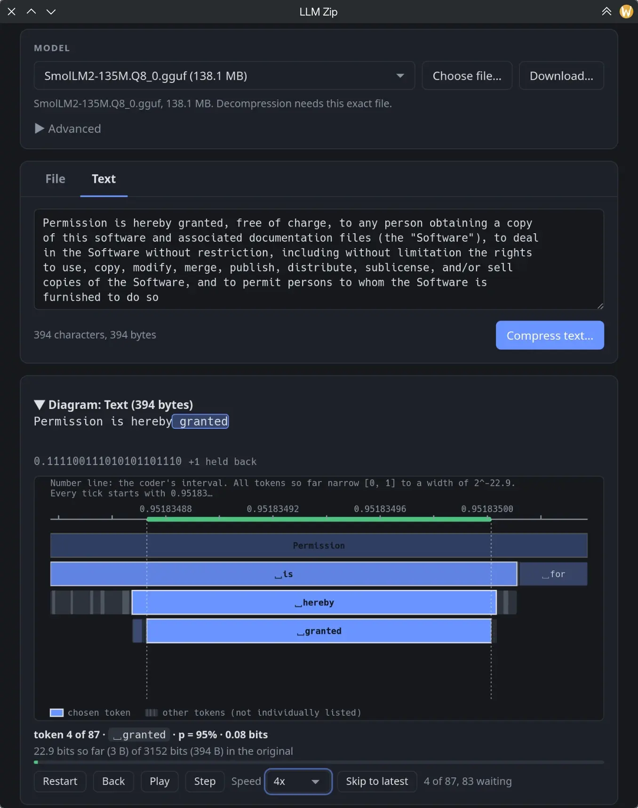

# LLM Zip

<table><tr><td>

A desktop app that compresses files with a language model. Drop a file on the window and it becomes a `.llmz` file. Drop an `.llmz` file and it decompresses and checks the result against a stored SHA-256.

The app is a small [tinyjs](https://github.com/tarwin/tinyjsapp) window (about 6 MB, no Electron). The compressor is [llama-zip.js](https://github.com/VibedByKaKi/llama-zip.js), a JavaScript port of [llama-zip](https://github.com/AlexBuz/llama-zip) that calls the llama.cpp library (libllama) through FFI. The app runs it in a worker thread, so the window stays responsive. The 3Blue1Brown video [This algorithm changed how I think about compression](https://www.youtube.com/watch?v=qbsb9DpdZ6s) explains the technique. See "How it works" below.

</td><td>



</td></tr></table>

## How it works

The video describes the method this app uses. The sender and the receiver each have the same language model. For every character or token, the model gives a probability for each possible next one. An arithmetic coder uses those probabilities to narrow the interval from 0 to 1 to a small region for the whole text. The compressed file is one binary number inside that region, plus the text length.

The decoder runs the same model on the same text so far and checks which region the number falls in, which recovers the text one step at a time. A message of probability `p` needs about `-log2(p)` bits, which is Shannon's limit, so text the model predicts well becomes very small. The video shows the preamble of the US Constitution shrinking from about 2,500 bits in ASCII to about 45 bits with a half-billion-parameter model.

How this project relates to the video:

- `llama-zip.js` is the arithmetic coder, and the llama.cpp model is the predictor. Compression quality depends on the model, so a larger model compresses better and runs slower.
- Decompression needs the exact same model, and any change in the predictions breaks the decoding. This is why the `.llmz` header stores a model fingerprint, and why it also stores the thread count, batch size and llama.cpp build the predictions came from. A different machine or build may fail to decompress a file.
- The Hutter Prize scores the decoder size as well as the compressed data. This app does not, and the model file is the largest part of what you need to keep to decompress.
- The video's closing argument is that compression and prediction are equivalent, which is why a better language model is a better compressor.

### The live diagram

The Diagram panel redraws the video's picture from your own model while a job runs. It follows the step stream of llama-zip.js, one step per coded token:

- The text so far, with the current token highlighted.
- The binary number that grows as the coder settles bits, with the newest bits highlighted.
- A number line with the coder's exact interval. Its tick labels gain decimal digits as the interval narrows, like 0.698251915 in the video. The page computes the interval with BigInt from every emitted bit plus the coder's 64-bit window and its held-back bits, so it stays exact however long the message is (a 1500 token test stream with 9000 bits takes about 7 ms per frame in txiki.js). The caption gives the width, 2^-bits.
- Stacked layers of probability bars labeled with tokens. Each layer is the model's top 16 candidates, laid out in token id order inside the chosen bar of the layer above. The chosen bar is highlighted. The camera then zooms into the chosen bar until it covers the middle 64% of the width, with empty space on each side, and dotted lines mark its edges. The older layers keep extending past those lines, so the bars they did not choose stay visible, as in the video. They slide up and fade as the next layer appears under the chosen bar, and the next zoom starts from the view where the last one ended. The last step zooms into the end token the same way. The number line ticks only the part between 0 and 1. Each layer is drawn at its own scale.
- The tokens outside the top 16 are drawn as thin grey bars between the listed ones. The model gives only their total probability, so the bars are a texture and their places mean nothing. The legend and tooltips say "other tokens (not individually listed)".
- The bits of the current token (`-log2(p)`) and the running total against the size of the original.

The panel has Play and Pause, Step, Back, Restart and a speed from 0.25x to the fastest setting. The worker sends steps in batches about every 100 ms and the page queues them, so the animation can run behind the compression. "Skip to latest" jumps to the newest step. Compression does not wait for the drawing. Recording the steps costs about 20% of the speed (821 tokens took 18.0 s without and 21.4 s with), and the compressed bytes are identical.

For text, the panel is open and recording by default. For files, tick "Diagram for files" under Advanced to record the first 200 tokens. A text job that ran without the panel can be drawn afterwards with "Show diagram for this text" on its row, which runs the coder again without saving anything. "Replay diagram" plays a recording from its first step, and the page keeps the recordings of the last four jobs (at most 1000 steps each). The panel announces a summary such as "token 12 of 40, 0.3 bits" to screen readers at most every 1.5 seconds, and it shows each step without easing when the system asks for reduced motion.

## Requirements

- macOS 15 or later, Windows 10/11, or Linux with WebKitGTK 4.1
- libllama from llama.cpp 1.0.0 (build 12359). llama-zip.js passes structs to the library by value with layouts written for that release, so it asks the library for its version when it loads it. An older library (it has no `llama_version()`) or a newer one fails with an error that says so. Install it with Homebrew (macOS and Linux) or winget (Windows), see below. No Python is needed.
- Disk space and RAM for a model (see below).

## Install libllama

On first launch the app offers to install libllama for you. The install box reads `Install… | using Homebrew` on macOS and Linux and `Install… | using winget` on Windows. Press the button:

- Homebrew runs `brew install llama.cpp`.
- winget runs `winget install --id ggml.llamacpp --exact --accept-package-agreements --accept-source-agreements`. The package id `ggml.llamacpp` comes from the llama.cpp repository's winget workflow and from winget package listings that a web search returned. It is unverified in practice, because winget was never run (there is no Windows machine here). It installs a Vulkan build of the latest release, which may be newer than the tested 1.0.0, and then the version check rejects it. The install box says so. Homebrew installs 1.0.0 at the time of writing. The library is `libllama.so.1.0.0` on Linux, `libllama.1.dylib` on macOS and `llama.dll` on Windows. Set `LLAMA_ZIP_ALLOW_UNTESTED=1` to use another version at your own risk, a changed struct layout can corrupt calls silently.

The installer output streams into the window, and Cancel stops it. "Check again" looks for the library again. The app looks for libllama in this order, the same as llama-zip.js:

1. A file you chose with "Use an existing libllama…". The app remembers it.
2. The `LLAMA_LIB` environment variable, as a full path.
3. The Homebrew and system library folders (`/opt/homebrew/lib`, `/home/linuxbrew/.linuxbrew/lib`, `/usr/local/lib`, `/usr/lib` and the Debian multiarch folders). On Windows, the folder winget unpacks the package into, `%LOCALAPPDATA%\Microsoft\WinGet\Packages\ggml.llamacpp_*`. That Windows folder is not in llama-zip.js's own list, and it was not tested.

Set `LLMZIP_DRY_RUN_INSTALL=1` to try the install flow without installing anything. The app prints the command it would run, simulates a few lines of output over about two seconds, and changes nothing. The install button works in a dry run even when Homebrew or winget is missing, and Cancel works. Any value except empty, `0` or `false` turns it on. For example: `LLMZIP_DRY_RUN_INSTALL=1 tinyjs dev`. The install card only shows when libllama is not found. To see it on a machine that has libllama, also set `LLMZIP_HIDE_LIBLLAMA=1`, which makes the library lookup find nothing: `LLMZIP_HIDE_LIBLLAMA=1 LLMZIP_DRY_RUN_INSTALL=1 tinyjs dev`.

If the package manager is not on your machine, the app says so and links to the [Homebrew](https://brew.sh/) or [winget](https://learn.microsoft.com/windows/package-manager/winget/) install guide. It does not install Homebrew or winget itself.

## Get a model

Open "Download…" next to the model picker. There are three ways to get a model:

- **The list.** Five base models from SmolLM2 135M (138 MB) to Llama 3.1 8B (4.7 GB), downloaded from Hugging Face. The app checks each file against its published SHA-256 and deletes a file that does not match.
- **A URL.** Paste any https link to a `.gguf` file. Hugging Face "blob" page links are rewritten to the file link. The app checks the `GGUF` magic bytes, so a link that returns a web page fails instead of saving the page.
- **A file.** "Choose file…" picks a `.gguf` already on disk.

Downloads go to `models/` inside the app's data folder. Only one download, install or job runs at a time, and compression jobs wait for a download or install. Speed depends on size. SmolLM2 135M (Q8_0) codes about 45 tokens per second on the 16-core CPU this was measured on. 3000 bytes of English text (821 tokens) took 18 s, which is about 165 bytes per second, and became 417 bytes of coded data plus the header. A larger model compresses better and runs slower.

## Use

1. Choose or download a model.
2. On the File tab, drop one or more files on the window, or open the Text tab, type or paste text, and press "Compress text…" (Cmd or Ctrl+Enter also works). The app writes the `.llmz` file to the system temporary folder (`app.vibedbykaki.llmzip` inside it) and deletes it on the next launch. Press "Save…" on the finished job to copy it where you want it. The finished job also shows the size [LZMA-JS](https://github.com/LZMA-JS/LZMA-JS) (level 9) gives for the same input, for comparison. Text is encoded as UTF-8 and stored under the name `text.txt`. Jobs run one at a time, and Cancel aborts the running job through an `AbortSignal` without writing an output file.
3. Decompress with the same model file. The app compares a fingerprint of the model (size plus SHA-256 of its first and last megabyte) and refuses a different one unless you click "Try anyway".

## The .llmz format

| Bytes | Content |
| --- | --- |
| 4 | Magic `LLMZ` |
| 1 | Format version (3) |
| 1 to 3 | Length N of the header, as a varint |
| N | Header, binary |
| rest | Output of the llama-zip.js coder |

A varint holds 7 bits per byte, least significant first, with the high bit set on every byte but the last. A string is a varint length followed by UTF-8 bytes. The header holds these fields in order:

| Field | Size |
| --- | --- |
| Original size | varint |
| Token count, including the end token | varint |
| SHA-256 of the original, truncated | 8 bytes |
| Original file name | string |
| Model name | string |
| Model size | varint |
| Model fingerprint (SHA-256 of its first and last megabyte), truncated | 8 bytes |
| `nCtx`, `nCtxUsed`, `overlapTokens` | 3 varints |
| GPU layer count (zigzag, because it can be -1) | varint |
| `nThreads` (4), `nBatch` (512) | 2 varints |
| llama.cpp version and build the library reports, for example `1.0.0 (build 12359)` | string |
| Digest of the CPU feature string, truncated | 4 bytes |

The header is about 90 bytes, so it is under a fifth of what it was in format version 2 (about 490 bytes of JSON). The hashes are truncated because they only have to catch a wrong model or a wrong decode, which gives garbage, and a 64-bit prefix lets a wrong result through about once in 2^64 times. The CPU feature string is kept as a 4-byte digest, so the app can tell that the CPU differs from the one that made the file but not how. Files in format version 2 (JSON header) still open.

Decompression uses the stored values, checks the model fingerprint, and checks the length and the truncated SHA-256 of the result. The output file is written only when both match.

Version 1 files came from the Python `llama-zip` that earlier versions of this app ran. The coder in llama-zip.js is not interchangeable with the Python one, so this version refuses a version 1 file with a message and does not try to decode it. The data after the version 1 header is plain `llama-zip` output, so the Python tool can still decode it.

## Limits

- **Speed.** About 45 tokens per second with SmolLM2 135M, which is roughly 165 bytes per second of English. A larger model is slower. The JavaScript port is slower than the Python tool (about 100 tokens per second on the same model), because the softmax over the vocabulary runs in txiki.js's interpreter. Compress files that are worth the wait. The whole input and output are held in memory.
- **Determinism.** llama.cpp does not promise identical output across hardware or builds. The logits are bit-identical only for the same thread count, batch size and chunking, so the header stores `nThreads` and `nBatch` and decompression reuses them. A different CPU, a different llama.cpp build, or a GPU can still change the results. The checksum turns a silent failure into an error, the app deletes the bad output, and the error shows the stored and current llama.cpp version and CPU features when they differ. Do not assume that a file made with llama.cpp b10180 decodes on 1.0.0: one such file (37 tokens, SmolLM2-135M) failed to decode after the upgrade, so files made before 1.0.0 should be decompressed on the old build.
- **Models newer than libllama.** A model with an architecture that the installed llama.cpp does not know fails to load. The app then says "This model needs a newer llama.cpp than the one installed (<version>). Update llama.cpp or choose another model." LFM3 (architecture `lfm3`) loads and round trips on 1.0.0.
- **Old files.** Version 1 files cannot be opened (see the format section).
- **GPU.** GPU layers default to 0. Earlier versions saw NaN probabilities from GPU offload on one Intel Mac. With 0 layers the app keeps every operation on the CPU.
- **Binary files.** Any bytes are accepted, but a language model predicts text well and other data poorly. Some tokenizers cannot round trip a few byte values. SmolLM2 135M drops 0x04, 0x06, 0x13, 0x14, 0x16 and 0x1d, and a file that contains them fails the checksum on decompression.
- **Signed macOS builds.** tinyjs signs with the hardened runtime when you give it a signing identity, and it adds no `disable-library-validation` entitlement. macOS may then refuse to load the Homebrew libllama into the signed app. The default ad-hoc signature does not have this problem. This was not tested, because there is no Mac here.
- **Window.** The window itself was only checked on Linux.

## Develop

```sh
git clone --recurse-submodules https://github.com/VibedByKaKi/llmzip-desktop
# or, in an existing clone
git submodule update --init

git clone https://github.com/tarwin/tinyjsapp && cd tinyjsapp && ./setup.sh
cd /path/to/llmzip-desktop
/path/to/tinyjsapp/tinyjs dev      # run with hot reload
/path/to/tinyjsapp/tinyjs build    # dist/LLM Zip.app, dist/llmzip
```

The page is in `src/frontend/` (`diagram.js` draws the diagram), and the backend is `src/backend/main.js`. The model runs in `src/backend/engine-worker.js`, a txiki.js Worker, and `src/backend/libllama.js` finds libllama and the package manager.

llama-zip.js is a git submodule at `src/backend/vendor/llama-zip.js`, pinned to a commit. It sits inside `src/backend/` because tinyjs ships only that folder with the backend. A submodule at the repository root would be missing from both `tinyjs dev` and `tinyjs build`. To move to a newer llama-zip.js:

```sh
git -C src/backend/vendor/llama-zip.js fetch && git -C src/backend/vendor/llama-zip.js checkout <commit>
git add src/backend/vendor/llama-zip.js && git commit
```

`tinyjs build` on Linux compiles the backend with `tjs app compile`. The compiled binary carries the worker and the vendored modules, and Workers and `tjs:ffi` work inside it (checked with a headless run of the compiled backend). The macOS `.app` ships the same files as plain data next to a stock `tjs`.

The backend can run without a window under `tjs run` for testing. It needs an object with `push` and `paths` methods as `app`, and `LLAMA_LIB` can point at libllama. For example:

```js
import { api } from './src/backend/main.js';
const app = { push: (name, data) => {}, paths: async () => ({ data: '/tmp/llmz-data' }) };
await api.compress({ input: 'file.txt', output: 'file.llmz', overwrite: true, model: '/path/model.gguf' }, app);
```

```sh
tjs run headless.js
```

## License

MIT. See `LICENSE`.
